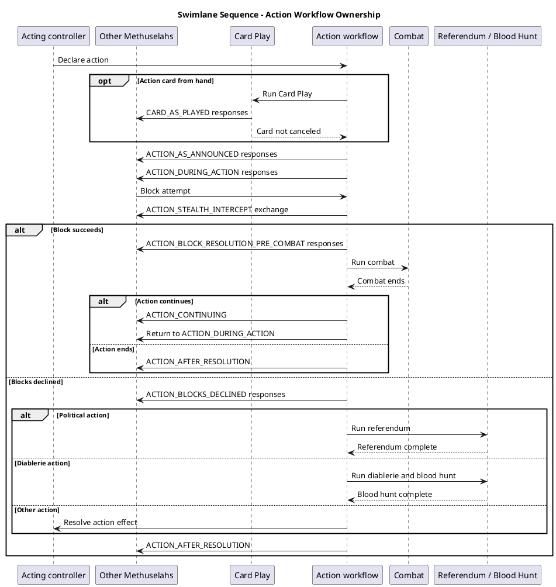
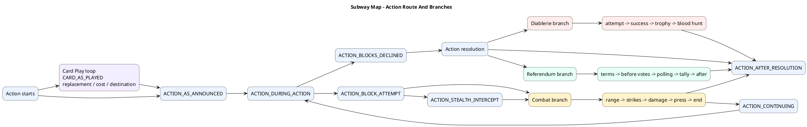
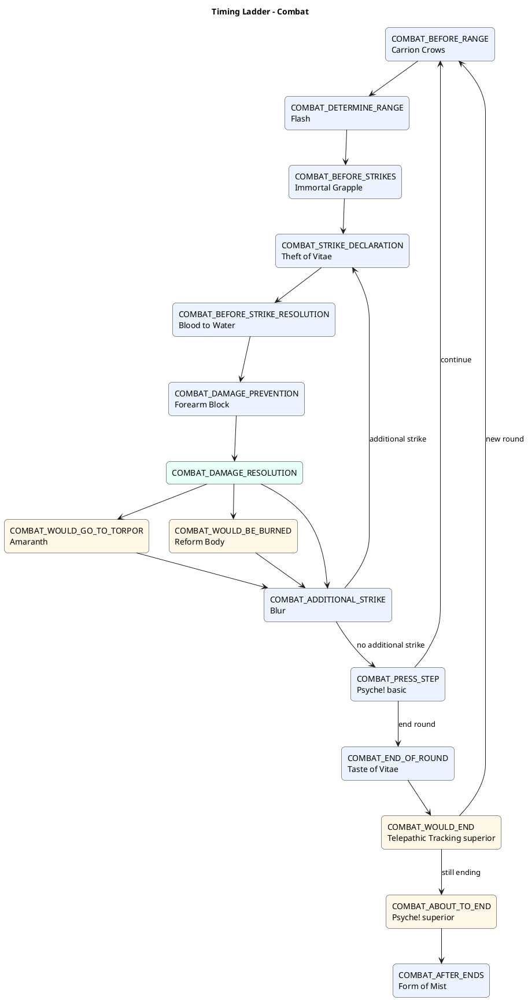
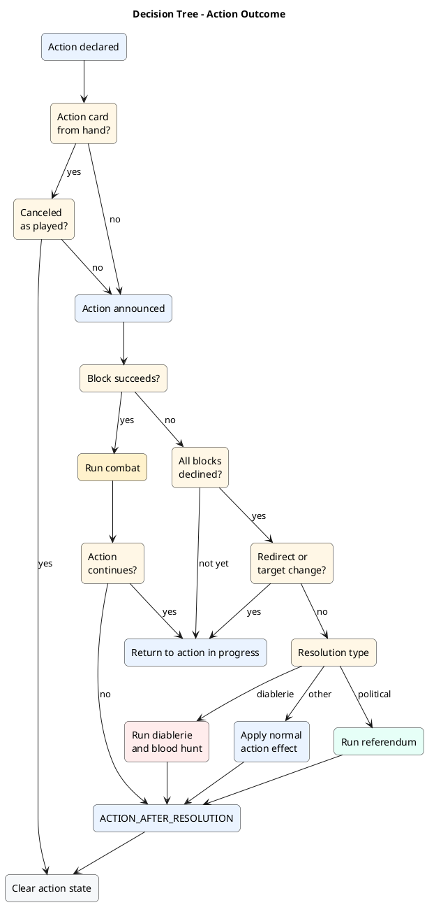

# Timing Window Visual Examples

These are draft visual examples for the layout ideas in [Timing Window Review Guide](./timing-window-review-guide.md#alternative-visual-layouts). They are intentionally review-friendly rather than canonical. The canonical implementation source remains [action-state-machine.puml](./action-state-machine.puml).

The examples use PlantUML so they can be rendered with the same tooling as the canonical state machine:

```bash
plantuml -tsvg docs/implementation/timing-window-visual-examples.md
```

---

## 1. Swimlane Sequence

Use this when reviewers need to see who owns each step and when control moves into nested workflows.



---

## 2. Subway Map

Use this as a one-page orientation map. It emphasizes routes and branch points instead of every implementation edge.



---

## 3. Timing Ladder

Use this for a focused subset. This example is the combat ladder.



---

## 4. Scenario Trace Card

Use this for one tricky edge case. This example traces Amaranth replacing torpor with diablerie during combat.

```plantuml
@startuml
title Scenario Trace - Amaranth During Combat
left to right direction

skinparam rectangle {
    RoundCorner 12
}

rectangle "Setup:\nA combat result would move\nthe opposing vampire to torpor" as Setup #F6F8FA
rectangle "COMBAT_DAMAGE_RESOLUTION\npending torpor result exists" as Damage #E6FFF7
rectangle "COMBAT_WOULD_GO_TO_TORPOR\ntorpor replacement window" as Torpor #EAF3FF
rectangle "CARD_AS_PLAYED\nAmaranth can be canceled\nas it is played" as CardPlay #F4EDFF
rectangle "DIABLERIE_CANCEL_OR_REPLACE\ndiablerie attempt begins" as Diablerie #FFECEC
rectangle "Blood Hunt\npolling -> result -> burn replacement" as BloodHunt #E6FFF7
rectangle "Return:\nresume combat ending at\nCOMBAT_END_OF_ROUND" as Return #FFF2CC

Setup --> Damage
Damage --> Torpor
Torpor --> CardPlay
CardPlay --> Diablerie
Diablerie --> BloodHunt
BloodHunt --> Return
@enduml
```



Reviewer prompts:

| Question | Expected answer |
|----------|-----------------|
| Is Amaranth a blood hunt card? | No. It replaces the pending torpor result. |
| Does `CARD_AS_PLAYED` replace `COMBAT_WOULD_GO_TO_TORPOR`? | No. It is nested inside the card play. |
| After blood hunt, is combat already fully cleared? | No. Combat still runs ending hooks. |

---

## 5. Decision Tree

Use this when the reader wants to answer "what happens next?" without learning every window name first.



---

## 6. Window Matrix

Use this for card-text classification review. It is a table-first image: the goal is fast lookup rather than path following.

| Workflow | Early window | Middle window | Result or replacement | After / return |
|----------|--------------|---------------|-----------------------|----------------|
| Card Play | `CARD_AS_PLAYED` | replacement and cost | destination | enclosing workflow resumes |
| Action | `ACTION_AS_ANNOUNCED` | `ACTION_DURING_ACTION`, `ACTION_BLOCK_ATTEMPT`, `ACTION_STEALTH_INTERCEPT`, `ACTION_BLOCKS_DECLINED` | `ACTION_RESOLUTION_SUCCESS`, `ACTION_BLOCK_RESOLUTION_PRE_COMBAT` | `ACTION_CONTINUING`, `ACTION_AFTER_RESOLUTION` |
| Combat | `COMBAT_BEFORE_RANGE` | range, strikes, damage | `COMBAT_WOULD_GO_TO_TORPOR`, `COMBAT_WOULD_BE_BURNED`, `COMBAT_WOULD_END`, `COMBAT_ABOUT_TO_END` | `COMBAT_AFTER_ENDS`, enclosing action return |
| Referendum | `REFERENDUM_CHOOSE_TERMS` | `REFERENDUM_BEFORE_VOTES`, `REFERENDUM_POLLING` | `REFERENDUM_RESOLUTION` | `REFERENDUM_AFTER_RESOLUTION`, then action after-resolution |
| Diablerie | `DIABLERIE_CANCEL_OR_REPLACE` | blood transfer, equipment, burn victim | `DIABLERIE_AFTER_SUCCESS`, `TROPHY_AWARD_BEFORE_BLOOD_HUNT` | blood hunt |
| Blood Hunt | `BLOOD_HUNT_POLLING` | vote-source count | `BLOOD_HUNT_RESOLUTION`, `BLOOD_HUNT_WOULD_BURN_DIABLERIST` | enclosing workflow return |

Color-coding suggestion for a rendered image:

| Color | Meaning |
|-------|---------|
| Blue | Player card/effect window |
| Green | Automatic rules resolution |
| Amber | Decision, vote, or result branch |
| Purple | Nested card-play lifecycle |
| Red | Diablerie or burn-risk path |
